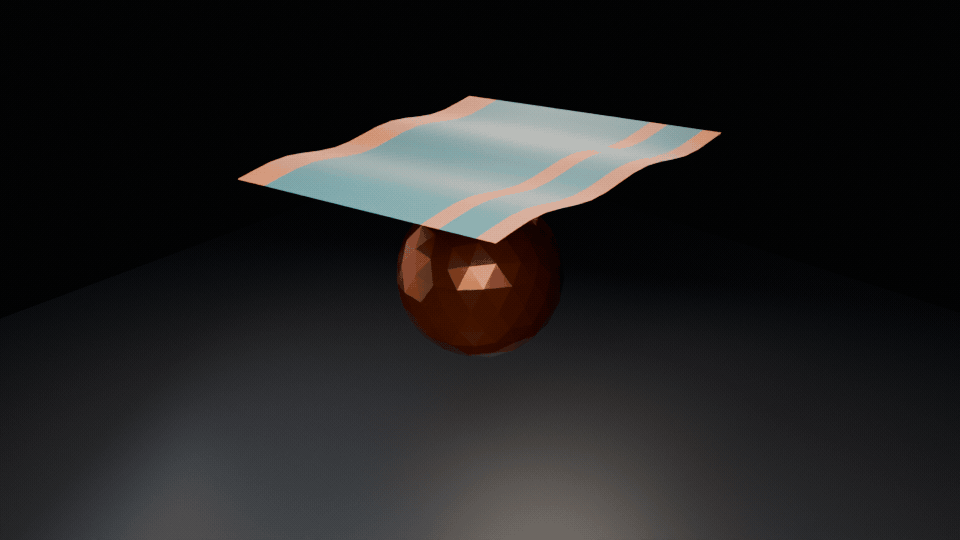

# AndoSim: Ando Barrier Physics



AndoSim is a Blender add-on that ports the SIGGRAPH 2024 method from ["A Cubic Barrier with Elasticity-Inclusive Dynamic Stiffness"](https://doi.org/10.1145/3687908) into day-to-day cloth and shell work. The solver implements the paper's barrier formulation in a C++ core (Eigen + pybind11), with the Python layer doing orchestration and UI only.

### What works today

- **Elastic cloth and a bounded rigid-sphere contact.** The animation above drops a free sheet onto a faceted sphere. Its 16 Blender-baked shape keys come from the native solver, with no post-bake mesh animation. The measured minimum clearance from the collider mesh across 866 native steps was 5.26 mm. The material settings are for demonstration, not calibrated silk.
- **Pins hold.** Pinned vertices are projected onto their targets every step, so a corner cannot slide off its pin.
- **Gravity and strain limitation** behave: a free sheet falls at g t²/2, and strain limiting is available per material preset.
- **Bakes write shape keys**, one per frame, so you can scrub the result or render it directly.
- **Ground-plane contact** stops a sheet that reaches the floor, provided the substep keeps motion inside the barrier range. The bake now sizes substeps from the fastest vertex to do exactly that.

### What is still being finished

Other contacts are not established by this demo. Moving rigid bodies, self-contact and long bakes remain unverified; the two existing broad end-to-end contact tests are still marked xfail. The [showcase notes](docs/example_images/README-showcase.md) give the native regressions, the Blender clearance check and the limits of that check.

### Try it

- Artists and tech animators: follow [docs/GETTING_STARTED.md](docs/GETTING_STARTED.md). It walks through installing the add-on, linking the core module, and running your first cloth drop in the viewport.
- Developers: prerequisites are CMake, Eigen3, and pybind11. From the project root run `./build.sh` (tests: `./build.sh -t`). This compiles the C++ extension into `blender_addon/` so Blender can import it.
- Prebuilt modules must match Blender's bundled Python **major.minor**, plus OS and architecture. Check the version in Blender's Python Console before downloading a release binary.
- Trying the CUDA backend? Make sure `extern/ppf-contact-solver` is pulled via `git submodule update --init --recursive`, then pick **PPF Contact Solver** in the add-on preferences.

### Regenerating the animation

The image above is rendered from the native solver, not animated by hand. After building the matching Blender core (see [local validation](docs/dev/LOCAL_VALIDATION.md)), run from the project root:

```bash
blender -b --factory-startup --python-exit-code 1 \
  --python docs/example_images/render_demo.py -- \
  --scene sphere --frames 16 --dt 2 --gap .08 --render-every 1 \
  --res 960 540 --samples 32 --cam-dir .9 -1 .65 \
  --core build/ando_barrier_core.cpython-313-x86_64-linux-gnu.so \
  --out scratch/sphere-followup/wide16
ffmpeg -framerate 12 -i scratch/sphere-followup/wide16/f%03d.png \
  -filter_complex '[0:v]tpad=stop_mode=clone:stop_duration=0.5,split[a][b];[a]palettegen=max_colors=128:stats_mode=diff[p];[b][p]paletteuse=dither=bayer:bayer_scale=3' \
  -loop 0 docs/example_images/sphere-contact.gif
```

The core filename must match your Blender Python ABI. The script checks the loaded module, native-step mesh clearance, finite baked keys and camera coverage before rendering. `--scene drape` preserves the original pinned-corner demo; `showcase` is a separate contact-free sail experiment.

### Want to dig deeper?

- [docs/BLENDER_QUICK_START.md](docs/BLENDER_QUICK_START.md) summarizes the add-on panels, realtime playback workflow, and common troubleshooting steps.
- `docs/dev/PROJECT_SPEC.md` and `docs/dev/MILESTONE_ROADMAP.md` trace every decision back to the paper and outline what is coming next.
- Standalone demos live in `demos/`, and `tests/` holds the C++ unit suite that guards the solver math.

### Join in

- File bugs or feature requests on GitHub: `https://github.com/Slaymish/AndoSim`
- Reach out on Discord (Slaymish) or email (hamishapps@gmail.com) if you want to contribute, pair on a feature, or share a scene.
- Friction, export tooling and contact robustness are the open fronts right now.
