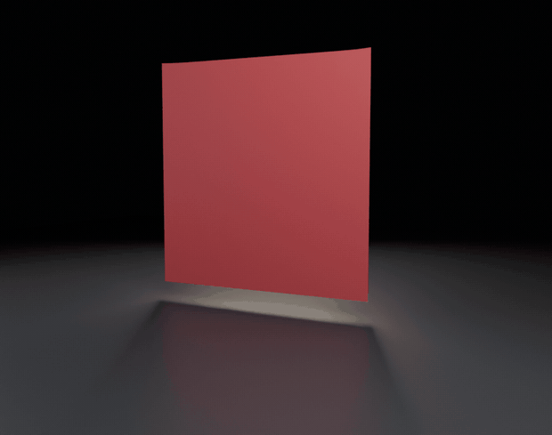

# AndoSim: Ando Barrier Physics



AndoSim is a Blender add-on that ports the SIGGRAPH 2024 method from ["A Cubic Barrier with Elasticity-Inclusive Dynamic Stiffness"](https://doi.org/10.1145/3687908) into day-to-day cloth and shell work. The solver implements the paper's barrier formulation in a C++ core (Eigen + pybind11), with the Python layer doing orchestration and UI only.

### What works today

- **Elastic cloth.** The deformation gradient is measured against the live pose, so sheets stretch, sag and buckle instead of behaving like rigid planes. The animation above is a 2 m sheet pinned at two corners, baked at a 1 ms substep.
- **Pins hold.** Pinned vertices are projected onto their targets every step, so a corner cannot slide off its pin.
- **Gravity and strain limitation** behave: a free sheet falls at g t²/2, and strain limiting is available per material preset.
- **Bakes write shape keys**, one per frame, so you can scrub the result or render it directly.
- **Ground-plane contact** stops a sheet that reaches the floor, provided the substep keeps motion inside the barrier range. The bake now sizes substeps from the fastest vertex to do exactly that.

### What is still being finished

Rigid-mesh contact is not reliable yet. The narrow phase returns an unsigned distance, so a body that crosses a triangle is treated as being outside it again, and a fast approach can jump the barrier entirely. Cloth-versus-sphere and cloth-versus-floor-at-speed scenes will still pass through. `test_collision_detection_setup` and `test_multi_frame_stability` are marked xfail for that reason, and [docs/dev/LOCAL_VALIDATION.md](docs/dev/LOCAL_VALIDATION.md) records what was measured.

### Try it

- Artists and tech animators: follow [docs/GETTING_STARTED.md](docs/GETTING_STARTED.md). It walks through installing the add-on, linking the core module, and running your first cloth drop in the viewport.
- Developers: prerequisites are CMake, Eigen3, and pybind11. From the project root run `./build.sh` (tests: `./build.sh -t`). This compiles the C++ extension into `blender_addon/` so Blender can import it.
- Prebuilt modules must match Blender's bundled Python **major.minor**, plus OS and architecture. Check the version in Blender's Python Console before downloading a release binary.
- Trying the CUDA backend? Make sure `extern/ppf-contact-solver` is pulled via `git submodule update --init --recursive`, then pick **PPF Contact Solver** in the add-on preferences.

### Regenerating the animation

The image above is rendered from the current solver, not captured by hand:

```bash
blender -b --factory-startup --python docs/example_images/render_demo.py -- \
    --scene drape --frames 30 --out /tmp/drape --dt 1 --gap 0.004
```

`--scene` also accepts `wave` (a corrugated sheet pinned at two corners) and `swing` (a curtain pinned along one edge). The bake writes the shape keys and the script renders each frame with Cycles, so any change to the solver can be re-shot the same way.

### Want to dig deeper?

- [docs/BLENDER_QUICK_START.md](docs/BLENDER_QUICK_START.md) summarizes the add-on panels, realtime playback workflow, and common troubleshooting steps.
- `docs/dev/PROJECT_SPEC.md` and `docs/dev/MILESTONE_ROADMAP.md` trace every decision back to the paper and outline what is coming next.
- Standalone demos live in `demos/`, and `tests/` holds the C++ unit suite that guards the solver math.

### Join in

- File bugs or feature requests on GitHub: `https://github.com/Slaymish/AndoSim`
- Reach out on Discord (Slaymish) or email (hamishapps@gmail.com) if you want to contribute, pair on a feature, or share a scene.
- Friction, export tooling and contact robustness are the open fronts right now.
